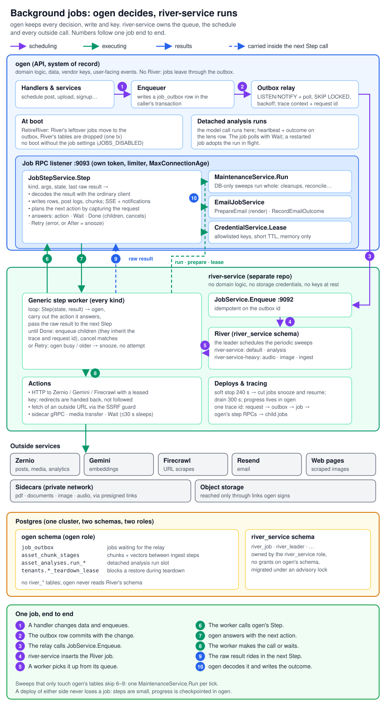

# river-service

Runs Ogen's background jobs. It owns the [River](https://riverqueue.com) queue,
takes jobs from ogen over `jobs.v1.JobService`, and works the queues listed in
`RIVER_QUEUES`. It is internal-only: ogen reaches it over Railway's private
network.



ogen stays the system of record. river-service has no access to ogen's tables
or object storage: its database role owns only the `river_service` schema, and
everything a job reads or writes goes through ogen's internal job RPCs. The
design is in Linear CON-332; the deployment configuration is CON-377.

## Status

Every job family now runs here (CON-332, phases 3–7); ogen has no queue of its
own. Each kind is registered in `internal/jobs`. A kind this build does not register
is refused by `Enqueue` with `UNIMPLEMENTED`, and ogen keeps it in its outbox.

| Family | Kinds | State |
| --- | --- | --- |
| Housekeeping | `cleanup_post_logs`, `cleanup_notifications`, `cleanup_login_security`, `cleanup_plugin_pairings`, `sweep_pending_uploads` | Scheduled here; each pass runs in ogen via `MaintenanceService.Run` |
| Email | `send_email`, `cleanup_email_logs` | ogen prepares and renders (`EmailJobService.PrepareEmail`), river-service sends through Resend with a leased key, ogen records the outcome (`RecordEmailOutcome`). The log sweep runs in ogen. |
| Harbor webhook | `notify_harbor_tenant_registered`, `notify_harbor_receipt_received` | Runs here; one worker posts each event to `HARBOR_WEBHOOK_URL` signed with a key leased from ogen. The payload is the event and one id (`tenant.registered` with the tenant id, `receipt.received` with the Resend email id); no email content rides in the job. |
| Zernio lifecycle | `bootstrap_zernio_profile`, `teardown_zernio_profile`, `detect_expiring_connections` (fans out into `detect_expiring_connections_tenant`), `cleanup_zernio_connect_sessions` | Step-run jobs (below): Zernio calls go out from here with a key leased from ogen, and ogen plans each one and applies the result (`JobStepService.Step`). The connect-session sweep runs in ogen. |
| Publishing | `submit_post_to_zernio`, `poll_zernio_status`, `cancel_zernio_job`, `withdraw_zernio_post`, `post_first_comment` | Step-run jobs. Submit streams each attachment from storage to Zernio (presign, then a media transfer). Polls snooze themselves until the post is published or fails. Withdrawing a post cancels its pending polls. |
| Publishing sweeps | `reconcile_scheduled_posts`, `detect_manual_publish_due`, `sweep_zernio_orphans` (fans out into `sweep_zernio_orphans_profile`), `refresh_zernio_analytics` (into `refresh_zernio_analytics_tenant`), `refresh_zernio_followers` (into `refresh_zernio_followers_tenant`) | Reconcile and manual-publish-due run in ogen through `MaintenanceService.Run`. The others fan out into one step-run job per tenant profile. |
| Ingestion | `process_pdf`, `process_document`, `process_url` (queue `ingest`), `process_image`, `reembed_image` (queue `image`), `process_audio` (queue `audio`) | Step-run jobs. Sidecar calls (pdf, documents, image, audio) go out from here: unary, or with the stored original streamed from storage. Gemini embeds use a leased key and Firecrawl scrapes too, and page images are fetched through the SSRF guard. ogen stages the parsed chunks between steps and commits them when the run ends. Image and audio checkpoint their progress in ogen, so an attempt cut short resumes where it stopped. |
| Asset analysis | `analyze_asset`, `reanalyze_campaign`, `distill_asset_ideas`, `backfill_asset_analyses` (queue `analysis`) | The model calls run in ogen. `analyze_asset` and `distill_asset_ideas` ask ogen to start the run detached, then wait on it with a poll every few seconds. A job restarted by a deploy finds the run in flight and waits on that one, so no deploy cuts a call. `reanalyze_campaign` is a single step. The backfill runs in ogen through `MaintenanceService.Run`. |
| Brand distillation | `distill_brand`, `expire_brand_distills` (queue `analysis`) | Step-run job. ogen admits the run, the site map (Firecrawl) goes out from here, the job snoozes while the run's sources ingest, then the model stages run detached in ogen and the job waits on them. The expiry sweep runs in ogen. |
| Weekly report | `weekly_report_dispatch` (fans out into `build_weekly_report`) | The hourly dispatch asks ogen which workspaces' Monday 09:00 has come; each build has ogen collect the week and queue the owners' `send_email` jobs, which come back here through the outbox. ogen's `WEEKLY_REPORT_ENABLED` decides whether anything is built. |
| Billing | `billing_apply_scheduled_change`, `billing_reconcile` (fans out into `billing_resync_subscription`), `billing_sync_payments`, `billing_webhook_events_sweep` | Lemon Squeezy calls go out from here with the key of the billing mode ogen runs in. A scheduled change pushes the plan switch an hour ahead (and reverts a push that landed after the owner kept the plan); ogen moves the tier at the effective time. The reconcile re-reads one subscription per child job and re-queues due changes; ogen skips it while billing is off. `billing_sync_payments` pages through the whole Lemon Squeezy payment history, one step per page, and ogen upserts each page into `billing_payments` (served to Harbor by `ListPayments`). It runs at start, which is the first backfill, then on its cadence to pick up refunds whose webhook was lost. A retry starts over from the first page; every page is an upsert. The webhook-log prune runs in ogen. |

### How a step-run job runs

Jobs that call outside services run on one generic worker (`internal/jobs/steps.go`):
1. It asks ogen for the next step (`JobStepService.Step`).
2. ogen answers with one of six things:
   - an HTTP call, either to a named API (`zernio`, `gemini`, `firecrawl`, `lemonsqueezy`, sent with that API's leased key; a redirect comes back as the result rather than being followed, so the key never goes elsewhere) or to an absolute URL fetched with no credentials through the SSRF guard
   - a sidecar gRPC call, unary or client-streamed from a stored file
   - a media transfer from storage to an upload URL
   - a wait: up to 30 s the worker sleeps and steps again with the same state; a longer one is a snooze
   - done, optionally with child jobs to enqueue
   - retry, now or after a delay
3. The worker carries it out (`internal/actions`) and passes the raw result to the next `Step`. A call to an API whose key isn't set in ogen is not made; the result says `credential_missing`, and ogen decides what that means.

Each `Step` call has its own 2-minute deadline, well inside the deploy drain. A step is short (long model calls run detached in ogen), so a call that runs past it means ogen is stuck: the job snoozes and gives its worker back instead of holding it for the rest of a long attempt.

ogen builds every request and decodes every response, so this service holds no domain logic: a new step-run kind is an args type plus one `newStepWorker` registration. A job cut short (a deploy, a crash) retries from the start, and every flow converges on a repeat.

A workspace teardown holds a short lease in ogen. While it's held, a restore of that workspace is refused, and each step renews the lease, so a stalled teardown frees the workspace within two minutes.

river-service is the only job runner: ogen has no queue of its own, and every
job ogen enqueues reaches this service through ogen's outbox.

## How it works

- **Enqueue.** ogen's relay calls `Enqueue` with the outbox row id as
  `idempotency_key`. The job and its key are written in one transaction, so a
  retried delivery returns the first job with `duplicate` set. A kind this build
  does not register (or one added to the contract after it was built) is refused
  with `UNIMPLEMENTED`, and the relay retries later.
- **Shutdown.** On SIGTERM the service stops answering `/readyz`, stops taking
  `Enqueue` calls, then stops River: running jobs get `SOFT_STOP_TIMEOUT` to
  finish, the rest are cancelled and rescheduled with a 5s snooze (no attempt
  used) so the replacement replica resumes them, and the stop gives up at
  `SHUTDOWN_TIMEOUT`. Telemetry is flushed last.
- **Scaling.** Replicas share the queue: River fetches with `SKIP LOCKED`, and
  only the elected leader schedules periodic sweeps. Replicas hold no state, so
  scaling is a change to the replica count.
- **Tracing.** Each job attempt's span is a child of the span that enqueued it
  (restored from the job's metadata) and links to it, so one trace id covers the
  ogen request, the job and the calls the job makes. Child jobs a step enqueues
  carry the same trace and request id. Fetches of outside URLs are spans too, but
  send no trace header to the outside host. Periodic sweeps start their own
  trace. Failures go to Sentry once retries are exhausted.

## Configuration

| Variable | Default | Meaning |
| --- | --- | --- |
| `DATABASE_DSN` | required | ogen's Postgres cluster, logging in as the `river_service` role |
| `DB_MAX_CONNS` | `10` | Connection pool size per replica. Keep replicas × this within the role's `CONNECTION LIMIT`. |
| `RIVER_SCHEMA` | `river_service` | Schema holding River's tables and the enqueue keys. Must exist and belong to the role. |
| `RIVER_QUEUES` | `default` | Queues this service works: `default`, `analysis`, `audio`, `image`, `ingest` |
| `JOB_WORKERS` / `ANALYSIS_JOB_WORKERS` / `AUDIO_JOB_WORKERS` / `IMAGE_JOB_WORKERS` / `INGEST_JOB_WORKERS` | `4` / `4` / `2` / `2` / `2` | Workers per queue on each replica |
| `SOFT_STOP_TIMEOUT` | `240s` | Time running jobs get to finish on shutdown before they are cancelled and rescheduled. Kept at least 15s below `SHUTDOWN_TIMEOUT`. |
| `SHUTDOWN_TIMEOUT` | `270s` | When the stop gives up. Must be below `RAILWAY_DEPLOYMENT_DRAINING_SECONDS`. |
| `RESCUE_STUCK_JOBS_AFTER` | `30m` | When a job left running by a dead replica is retried. Must exceed the longest attempt timeout. |
| `GRPC_ADDR` | `:9092` | Where `JobService` listens. Empty disables it (heavy service). |
| `GRPC_AUTH_TOKEN` | required with `GRPC_ADDR` | Bearer token ogen sends (ogen's `RIVER_SERVICE_AUTH_TOKEN`) |
| `OGEN_GRPC_ADDR` / `OGEN_RPC_AUTH_TOKEN` | empty | ogen's job-RPC listener (e.g. `dns:///ogen.railway.internal:9093`) and the token it expects (ogen's `RIVER_RPC_AUTH_TOKEN`). Without it no job kinds are registered. |
| `NOTIFICATIONS_CLEANUP_EVERY` / `PENDING_UPLOAD_SWEEP_INTERVAL` | `24h` / `1h` | Cadence of those two sweeps; `0` turns one off. Post logs run hourly, login security daily and plugin pairings every 15 minutes. |
| `ZERNIO_BASE_URL` / `ZERNIO_HTTP_TIMEOUT` | `https://zernio.com/api/v1` / `15s` | Zernio's API and per-call timeout. The key is leased from ogen; with none set, ogen ends Zernio jobs without doing anything. |
| `GEMINI_BASE_URL` / `GEMINI_HTTP_TIMEOUT` | `https://generativelanguage.googleapis.com` / `60s` | Gemini's API (embeddings) and per-call timeout. Key leased from ogen. |
| `FIRECRAWL_BASE_URL` / `FIRECRAWL_HTTP_TIMEOUT` | `https://api.firecrawl.dev` / `90s` | Firecrawl's API (URL scrapes, site maps) and per-call timeout. Key leased from ogen. |
| `LEMONSQUEEZY_BASE_URL` / `LEMONSQUEEZY_HTTP_TIMEOUT` | `https://api.lemonsqueezy.com/v1` / `15s` | Lemon Squeezy's API and per-call timeout, for the billing jobs. The key of the billing mode ogen runs in is leased from ogen. Point it where ogen's `LEMONSQUEEZY_BASE_URL` points. |
| `FETCH_TIMEOUT` | `30s` | Fetch of outside content (an image on a scraped page). These fetches never reach private, shared (100.64.0.0/10), loopback or link-local addresses. |
| `PDF_SERVICE_ADDR` / `DOCUMENTS_SERVICE_ADDR` / `IMAGE_SERVICE_ADDR` / `AUDIO_SERVICE_ADDR` | empty | Sidecar gRPC addresses, set on the heavy service. A sidecar left unset behaves as it does in ogen without it. |
| `SIDECAR_MAX_RECV_BYTES` | `134217728` (128 MiB) | Largest sidecar response accepted |
| `ZERNIO_HEALTH_CHECK_INTERVAL` | `6h` | Connection-health sweep cadence; `0` turns it off. |
| `ANALYSIS_BACKFILL_INTERVAL` | `15m` | Asset-analysis backfill cadence; `0` turns it off. The batch size (`ANALYSIS_BACKFILL_BATCH`) stays in ogen. |
| `BILLING_RECONCILE_INTERVAL` | `1h` | Billing reconcile cadence; `0` turns it off. The webhook-log prune runs daily and the brand-proposal expiry every 6 hours. |
| `BILLING_PAYMENTS_SYNC_INTERVAL` | `24h` | Cadence of the Lemon Squeezy payment-history sync (`billing_sync_payments`); it also runs once at start, which is the first backfill. `0` turns it off. |
| `WEEKLY_REPORT_CHECK_EVERY` | `1h` | How often the weekly report looks for workspaces due; `0` turns it off. `WEEKLY_REPORT_ENABLED` and `WEEKLY_REPORT_LIMIT_PCT` stay in ogen. |
| `RECONCILE_EVERY` / `MANUAL_PUBLISH_DUE_SWEEP_EVERY` | `5m` / `1h` | Cadence of the two publishing sweeps that run in ogen; `0` turns one off. |
| `ZERNIO_ORPHAN_SWEEP_INTERVAL` / `ZERNIO_ANALYTICS_REFRESH_INTERVAL` / `ZERNIO_FOLLOWER_REFRESH_INTERVAL` | `1h` / `1h` / `24h` | Cadence of the Zernio sweeps; `0` turns one off. Whether the orphan sweep withdraws anything (`ZERNIO_ORPHAN_SWEEP_LIVE`) stays in ogen. |
| `EMAIL_BASE_URL` / `EMAIL_HTTP_TIMEOUT` | `https://api.resend.com` / `15s` | Resend endpoint and per-call timeout. The API key is leased from ogen; with no key set in ogen, sends are logged as skipped. |
| `HARBOR_WEBHOOK_URL` | empty | Harbor's new-tenant webhook. Empty turns it off. The HMAC key (`X-Ogen-Signature`) is leased from ogen's `HARBOR_WEBHOOK_SECRET`; with none set the webhook goes out unsigned. |
| `HEALTH_ADDR` | `:$PORT`, else `:8080` | HTTP `/healthz` (process up) and `/readyz` (serving and database reachable). Unset, it follows `PORT`, which is where Railway sends healthchecks. |
| `LOG_LEVEL` / `LOG_FORMAT` | `info` / `json` | Logging; `LOG_FORMAT=text` for local runs |
| `SENTRY_DSN` | empty | Turns on tracing and error reporting. Also `SENTRY_ENVIRONMENT`, `SENTRY_RELEASE`, `SENTRY_TRACES_SAMPLE_RATE` (`0.1`), `OTEL_SERVICE_NAME` (`river-service`). |

river-service never holds API keys, storage credentials, model ids or ogen's
KEK. Job families that need a vendor key lease it from ogen.

## Deploying on Railway

Two services run the same image:

| Service | `RIVER_QUEUES` | `GRPC_ADDR` | Public domain |
| --- | --- | --- | --- |
| `river-service` | `default,analysis` | `:9092` | none (private network only) |
| `river-service-heavy` | `audio,image,ingest` | empty | none |

Both share one River schema, so the light service's `JobService` enqueues jobs
for either service's queues. Periodic sweeps are scheduled by whichever replica
is leader.

**Deploy settings, on both services:**

- `RAILWAY_DEPLOYMENT_DRAINING_SECONDS=300`. Railway sends SIGTERM once the new
  deployment is up and SIGKILL after this many seconds (default 0, which kills
  running jobs). It must exceed `SHUTDOWN_TIMEOUT`.
- `RAILWAY_DEPLOYMENT_OVERLAP_SECONDS=30` (about 30 seconds is enough), so
  the new replica is serving before the old one drains.
- Healthcheck path `/readyz`. Railway probes the port in `PORT`, and the
  health listener uses `PORT` when `HEALTH_ADDR` is unset, so leave
  `HEALTH_ADDR` unset on Railway. Restart policy: on failure.

**Variables per service.** Both: `DATABASE_DSN`, `RIVER_SCHEMA`,
`OGEN_GRPC_ADDR`, `OGEN_RPC_AUTH_TOKEN`, `SOFT_STOP_TIMEOUT`,
`SHUTDOWN_TIMEOUT`, `SENTRY_*`, `LOG_*`. `river-service` only: `GRPC_ADDR` and
`GRPC_AUTH_TOKEN` (the `JobService` ogen relays to), `HARBOR_WEBHOOK_URL`.
The sweep cadences (`*_EVERY`, `*_INTERVAL`) go on both, with the same
values: the two services share one schema and so one leader election, and
whichever replica leads schedules every sweep.
`river-service-heavy` only: `PDF_SERVICE_ADDR`, `DOCUMENTS_SERVICE_ADDR`,
`IMAGE_SERVICE_ADDR`, `AUDIO_SERVICE_ADDR` (the sidecars' private
addresses), `GEMINI_*` and `FIRECRAWL_*` overrides if any. The billing jobs
and the brand site map run on `river-service`, so `LEMONSQUEEZY_*` and
`FIRECRAWL_*` overrides go there too. Worker counts:
start with the defaults (4 default, 4 analysis, 2 each heavy queue) and one
replica of each; every analysis job holds a worker while ogen runs its model
call, so `ANALYSIS_JOB_WORKERS` × replicas is how many analyses run at once.

**Postgres.** Create the role and schema once, as a superuser on ogen's
database:

```sql
CREATE ROLE river_service LOGIN PASSWORD '…' CONNECTION LIMIT 20;
CREATE SCHEMA river_service AUTHORIZATION river_service;
```

Grant the role nothing on ogen's schema. The service creates its tables inside
`river_service` on boot, one replica at a time under an advisory lock.

**Private network.** ogen reaches `JobService` at
`dns:///river-service.railway.internal:9092` (ogen's `RIVER_SERVICE_ADDR`), and
river-service reaches ogen's job RPCs at
`dns:///ogen.railway.internal:9093` (river-service's `OGEN_GRPC_ADDR`, ogen's
`JOB_RPC_ADDR`). Define each token once as a Railway shared
variable and reference it from both services.

**Scaling.** Change the replica count. Watch queue depth and the age of the
oldest available job per queue, ogen's outbox relay lag, and ogen's job-RPC
limiter rejections; keep replicas × workers within ogen's limiter and vendor
quotas.

**Deploy order** for a new kind: tag the proto release, ship ogen with the
kind's steps or maintenance pass, then ship river-service with its
registration. A slip only delays jobs: river-service refuses a kind it
doesn't know, so its rows wait in ogen's outbox, and a step ogen doesn't serve
yet comes back `UNIMPLEMENTED` and the job snoozes.

**Rollback.** Roll back river-service to the previous image. Jobs of a kind
the older build doesn't know are refused at `Enqueue` and wait in ogen's
outbox until a build that knows them is back. Jobs already queued keep their
place in River's tables, which a rollback doesn't touch.

**ogen's old River tables.** ogen ran its own River until every kind moved
here (CON-332 phase 7). The first ogen boot without River moves every job its
River left unfinished into the job outbox, scheduled as it was, and drops
River's tables in the same transaction, so nothing waits for a drain. Jobs a
sweep fanned out into are not moved; the sweep's next tick here queues them
again.

## Development

```sh
make build        # binary
make test         # unit tests (database tests skip without TEST_DATABASE_DSN)
make test-db      # all tests against a throwaway Postgres container
make lint         # golangci-lint (gofmt, goimports, vet, staticcheck, …), as in CI
make proto        # regenerate gen/ from the pinned contract
make proto PROTO_SOURCE=../proto/proto   # from a local proto checkout
```

Generated stubs in `gen/` are committed. `jobs.v1` is pinned to
`buf.build/ogen-app/proto` `PROTO_VERSION` in the Makefile.
